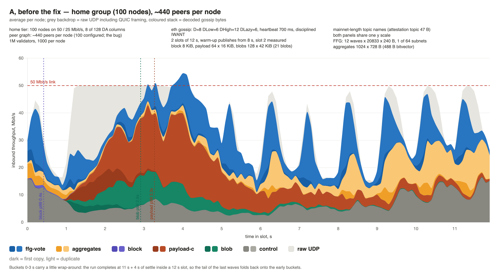
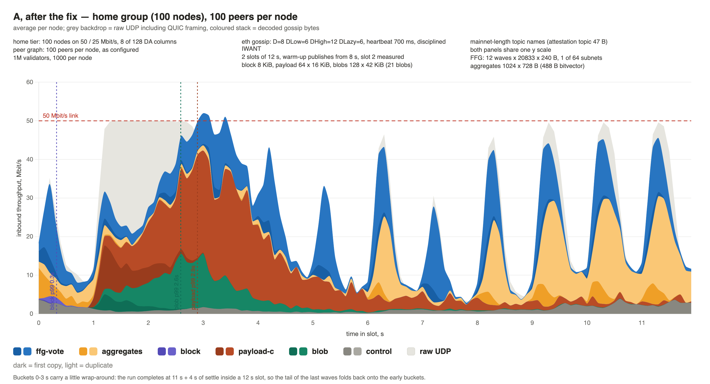
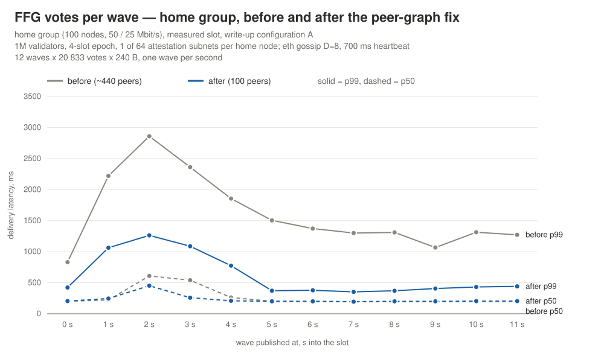
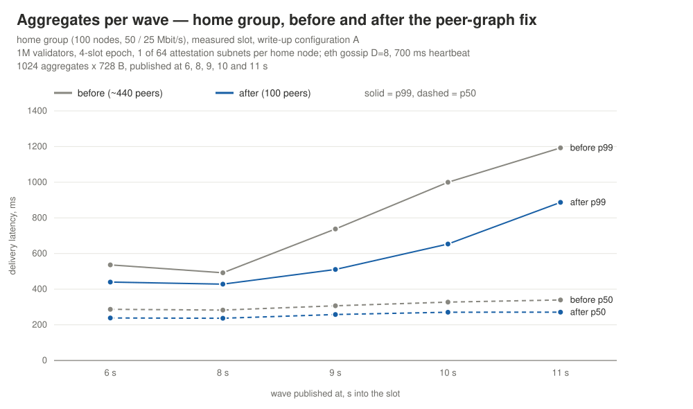

# DC gossip traffic profile: the peer-count fix

> **Update:** with stream-Snappy on the fixed graph and 2 attestation subnets, an epoch of 8, 4 or
> 3 slots fits on the 50 / 25 Mbit/s tier; 2 slots is past the comfortable range. See
> [the epoch-length ceiling with stream-Snappy](dc-slot-traffic-snappy.md).

A correction to [Gossip traffic profile for a slot](dc-slot-traffic-writeup.md). The peer graph the
simulations ran on was about **4× denser than configured**: nodes asked for 100 peers got ~440.
This note shows what that did to the numbers, by re-running configuration **A** with the graph
fixed and nothing else changed.

Note: this follow-up was mostly composed by Claude.

## TL;DR

- Every node in the write-up had ~4× its configured peers: **~440 instead of 100** for the home,
  VPS and mid/upper-home tiers, **734 instead of 200** for the pools.
- The mesh was not affected (D=8, DHigh=12 either way), so publish traffic barely moved. What
  moved is everything that scales with the *number of peers*, above all **IHAVE**.
- With the graph fixed, configuration A (4 slots per epoch, 1 attestation subnet per home node) gets cheaper and faster for the constrained node:
  - home inbound traffic: **54.4 → 39.6 MB** per measured slot (−27%);
  - home control traffic: **10.3 → 1.9 MB** (−82%);
  - home FFG vote p99: **1864 → 835 ms**; worst wave **2860 → 1263 ms**;
  - home aggregate p99: **1015 → 611 ms**.
- `IHAVE` traffic is no more the major bottleneck
- The write-up's conclusions on fit therefore hold with more headroom than stated. 

### The home node's slot, before and after

The same panel as in the write-up, for the 50 / 25 Mbit/s home group in configuration A, on one
y scale. Inbound throughput per node, averaged over the group, in 100 ms buckets across the
measured slot.

- **The grey control band is the difference.** Before the fix it never dropped below ~5 Mbit/s,
  and reached 10–16 Mbit/s late in the slot, where aggregates and votes add the most IHAVE. After
  the fix it is 1–4 Mbit/s throughout.
- **The bulk-data window still hits the link.** Payload and blobs saturate 50 Mbit/s from 1.2 s to
  ~3 s in both runs; that collision with the vote waves is not a graph artefact.
- **The burst clears sooner and the link drains between waves.** Before, the link stayed pinned
  until ~4.3 s; after, raw UDP falls away from the line by ~3.5 s. The 9–11 s waves still briefly
  reach the ceiling in both runs, but between them the link now drops to ~10 Mbit/s instead of
  staying at 20–35.
- **Aggregates now dominate the end of the slot.** Gold is the largest band from 9 s on, once
  control stops crowding them.

## How gossip changed

Configuration A: 4-slot epoch, 1 attestation subnet per constrained node. Same code, seed and
parameters as the write-up; only the graph differs.

| | before (~440 peers) | after (100 peers) |
|---|---|---|
| **network-wide, per node** | | |
| UDP sent, measured slot | 200.2 MB | **160.2 MB** |
| gossip control, whole run | 83.9 MB (95.5% IHAVE) | **44.9 MB** (97.2% IHAVE) |
| IHAVE ids received, whole run | 3.58 M | **1.96 M** |
| duplication (copies per delivery) | 8.95× | **8.52×** |
| **`home`, per node, measured slot** | | |
| inbound UDP | 54.4 MB | **39.6 MB** |
| gossip control | 10.3 MB | **1.9 MB** |
| FFG vote bytes | 13.7 MB | **10.8 MB** |
| IHAVE ids received, whole run | 700 k | **125 k** |
| **other groups, per node, measured slot** | | |
| `vps` inbound UDP | 100.4 MB | **66.9 MB** |
| `validator-pools` inbound UDP | 1171 MB | **1067 MB** |
| `validator-pools` gossip control | 399 MB | **303 MB** |

Delivery latency at the home tier, p50 / p99 in ms:

| | before | after |
|---|---|---|
| block | 207 / 418 | **183 / 326** |
| payload chunks | 943 / 2270 | **553 / 1895** |
| blob columns | 682 / 1914 | **549 / 1590** |
| FFG votes | 228 / 1864 | **220 / 835** |
| aggregates | 312 / 1015 | **258 / 611** |

Every type delivered to 100% of its subscribers in both runs.

The pools are the exception to "IHAVE was a graph artefact". They keep 200 peers and subscribe to
all 64 attestation subnets and all 128 DA columns, so their control traffic is still 303 MB per
slot, nearly all of it IHAVE. That is a real cost of the protocol, not of the graph.

## The bug

`peerGraph` built the connection graph in this order:

1. **Subnet coverage.** For *every* subnet a node subscribes to, its subscribers were arranged in a
   shuffled ring, giving each one `2 × ceil(minPeersPerSubnet / 2)` = 8 fresh peers on that subnet.
2. **Degree fill.** Nodes still below their configured peer count were paired up at random.

Step 1 ran unconditionally, whether or not the node already had enough peers on that subnet. Every
node subscribes to all **64 payload-chunk subnets**, so step 1 alone gave every node 64 rings ×
8 edges. After overlaps that is ~440 distinct peers, and step 2 then had nothing left to do.

The fix reverses the order. The graph is filled to the configured peer count first. Coverage is then
topped up only for a subscription still short of `minPeersPerSubnet` peers on its subnet: rarest
subnets first, from subscribers with the most room under their own target. Fill edges between two
nodes that the top-up pushed past their target are then dropped, as long as both ends stay covered.

| group | configured peers | degree before (p50) | degree after (p50) |
|---|---|---|---|
| `validator-pools` | 200 | 734 | **200** |
| `vps` | 100 | 479 | **100** |
| `upper-home` | 100 | 442 | **100** |
| `mid-home` | 100 | 441 | **100** |
| `home` | 100 | 440 | **100** |

The graph has 55 k edges instead of ~246 k. Every subscription still has at least 8 peers on its
subnet, and the graph is connected.

### FFG p99 per tier

The write-up argued that the attestation tail belongs to the network rather than to the receiving
node, because FFG p99 came out nearly the same on every tier. On the fixed graph the tiers separate:

| FFG p99, ms | `home` 50/25 | `mid-home` | `upper-home` | `vps` 500M | `validator-pools` 10G |
|---|---|---|---|---|---|
| A, before | 1864 | 1719 | 1835 | 1640 | 1592 |
| A, after | **835** | **574** | **569** | **498** | **449** |

Each tier's tail is now 2.2–3.5× shorter, and the 50 / 25 Mbit/s node's is the longest by a clear margin.
The network-wide component the write-up identified is still there: even the 10 Gbit/s pools sit at
449 ms. But it is now small enough that the constrained node's own link shows on top of it.

## Per-wave latency

Run parameters:

- 1M validators, 1000 per node; 1000 nodes in five groups (100 pools with 200 peers, 600 VPS,
  100 each of upper-, mid- and 50 / 25 Mbit/s home, 100 peers each).
- 2 slots of 12 s; the warm-up slot publishes from 8 s; slot 2 measured.
- eth gossip: D=8, DLow=6, DHigh=12, DLazy=6, heartbeat 700 ms; disciplined IWANT on the home tier.
- Block 8 KiB; payload 64 × 16 KiB; blobs 128 × 42 KiB (21 blobs); mainnet-length topic names.
- FFG: 12 waves × 20 833 × 240 B, one wave per second, 1 of 64 subnets per constrained node.
- Aggregates: 1024 × 728 B (488 B bitvector), published at 6, 8, 9, 10 and 11 s.
- **before** = the write-up's own run of configuration A; **after** = the same with the fixed graph.

All figures are home tier, measured slot, in milliseconds.

**FFG votes — 12 waves, one per second.**

| wave @ | before p50 | before p99 | after p50 | after p99 |
|---|---|---|---|---|
| 0 s | 201 | 832 | 205 | 423 |
| 1 s | 221 | 2221 | 245 | 1064 |
| 2 s | 610 | **2860** | 452 | **1263** |
| 3 s | 540 | 2362 | 259 | 1088 |
| 4 s | 262 | 1856 | 209 | 774 |
| 5 s | 201 | 1505 | 200 | 372 |
| 6 s | 196 | 1373 | 200 | 378 |
| 7 s | 196 | 1300 | 195 | 353 |
| 8 s | 194 | 1311 | 200 | 370 |
| 9 s | 194 | 1068 | 201 | 407 |
| 10 s | 198 | 1313 | 203 | 432 |
| 11 s | 200 | 1271 | 204 | 442 |
| **all waves** | **228** | **1864** | **220** | **835** |

The shape is the same, with the worst waves those published into the bulk-data window at 1–3 s.
But the recovery is far quicker. Before the fix the waves after the burst stayed at 1.1–1.5 s p99;
after it, every wave from 5 s on is under 450 ms. The median barely moves. What the extra ~340 peers
cost was the tail: IHAVE traffic competing with the votes for the same 50 Mbit/s link.

**Aggregates — 5 publication instants.**

| wave @ | before p50 | before p99 | after p50 | after p99 |
|---|---|---|---|---|
| 6 s | 287 | 536 | 238 | 440 |
| 8 s | 283 | 492 | 237 | 428 |
| 9 s | 307 | 738 | 258 | 511 |
| 10 s | 327 | 1000 | 271 | 653 |
| 11 s | 339 | **1193** | 271 | **887** |
| **all waves** | **312** | **1015** | **258** | **611** |

Aggregates still **degrade across the slot**, 440 → 887 ms p99, because each later wave queues
behind more accumulated vote traffic. The fix lowers the whole curve by 50–350 ms but does not
change that slope.

## What this means for the write-up

- **The "fits" verdicts for A and C stand, with more margin.** The constrained node carries 27% less
  inbound traffic per slot than the write-up's charts show.
- **B needs a re-run before its ⚠️ is final.** It was the configuration that did not fit, and
  whether it does on the fixed graph is open.
- **The IHAVE share is smaller than the write-up implies for the constrained tiers.** It is
  unchanged for the pools. The case for the Partial Messages extension now rests mainly on the
  pools and on attestation-heavy nodes, not on the home tier.
- **The "tail belongs to the network" argument needs restating** as above: the network-wide
  component is real, but no longer the whole of the home tier's tail.

Run on the 512 GB Mac Studio: 21 m 20 s of wall clock for the fixed-graph run, against 27 m 17 s
before.
