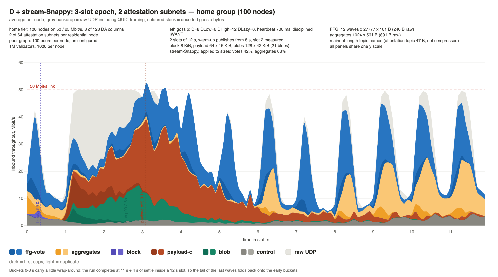
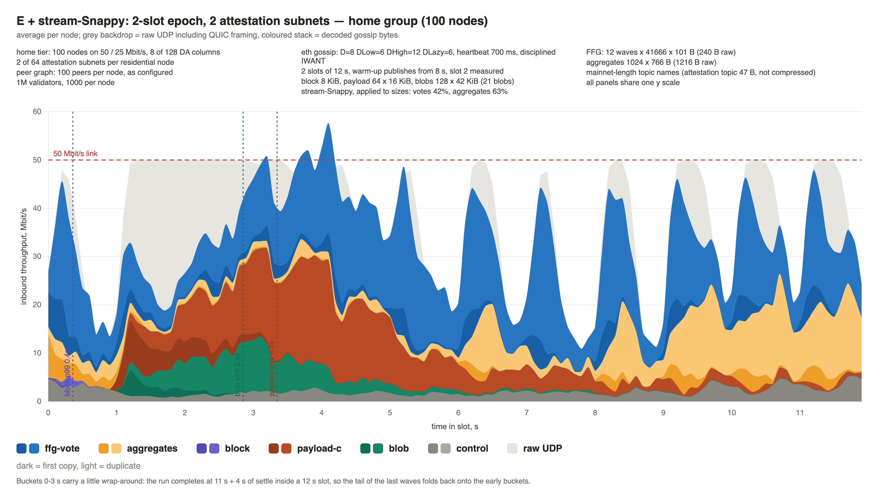

# DC gossip traffic profile: stream-Snappy and the epoch-length ceiling

The third note in the series, after [Gossip traffic profile for a slot](dc-slot-traffic-writeup.md)
and [the peer-count fix](dc-slot-traffic-followup.md). It re-runs the two 2-subnet configurations,
**B** and **C**, with [stream-Snappy](https://ethresear.ch/t/snappy-with-a-memory-40-less-gossip-traffic/26078/2)
on the fixed peer graph. It then shortens the epoch to **3** slots (**D**) and **2** slots (**E**),
keeping the 2 subnets, to find where a 50 / 25 Mbit/s node stops coping.

Note: this note was mostly composed by Claude.

## TL;DR

- Stream-Snappy cuts the home node's inbound traffic by about a quarter: **52.1 → 37.8 MB** per slot
  in B, **36.6 → 29.0 MB** in C.
- **B now fits.** Its FFG p99 halves (**1606 → 779 ms**), its worst wave goes from 2.5 s to 1.1 s,
  and the time the link spends saturated halves too. B with Snappy is better on every vote and
  aggregate figure than A without it.
- Aggregates stop degrading across the slot. Their worst wave is **≤ 490 ms** in every
  configuration with Snappy, against 480–1170 ms without.
- **The ceiling is a 3-slot epoch (D).** It fits, with about the margin A had without Snappy:
  FFG p99 1068 ms, worst wave 1.5 s, and the link recovers between the waves after the bulk-data
  window.
- **A 2-slot epoch (E) does not fit.** The home link is pinned from 1.2 s to 5.5 s and reaches its
  ceiling on every later wave. FFG p99 is 1.9 s, every wave's tail stays above 1.2 s, and the last
  waves are not fully delivered on any tier, the pools included.
- As before, the tail is set by the network rather than by the receiving node. In E, the
  10 Gbit/s pools have an FFG p99 of 1753 ms, against 1943 ms at the home tier.

## Result

| | | slots per epoch | attestation subnets | stream-Snappy |
|---|---|---|---|---|
| ⚠️ | B | 4 | 2 | no |
| ✅ | B | 4 | 2 | yes |
| ✅ | C | 8 | 2 | no |
| ✅ | C | 8 | 2 | yes |
| ✅ | D | 3 | 2 | yes |
| ❌ | E | 2 | 2 | yes |

The criteria are the write-up's: the link should not stay saturated, and the vote tail should not
run away from the median, judged on the worst of the twelve waves.

Home tier (50 / 25 Mbit/s), measured slot:

| | B | B + Snappy | C | C + Snappy | D + Snappy | E + Snappy |
|---|---|---|---|---|---|---|
| slots per epoch | 4 | 4 | 8 | 8 | 3 | 2 |
| inbound UDP | 52.1 MB | **37.8 MB** | 36.6 MB | **29.0 MB** | 43.8 MB | 54.5 MB |
| 100 ms buckets ≥ 95% of the link | 45 | **21** | 20 | **15** | 31 | 47 |
| FFG p50 / p99, ms | 242 / 1606 | 216 / **779** | 214 / 778 | 207 / **628** | 224 / 1068 | 251 / 1943 |
| FFG worst wave p99, ms | 2533 | **1146** | 1060 | **938** | 1529 | 3016 |
| aggregates p99, ms | 1047 | **466** | 462 | **397** | 697 | 1001 |
| aggregates worst wave p99, ms | 1169 | **488** | 480 | **407** | 906 | 1106 |
| payload chunks p99, ms | 2230 | 1954 | 1870 | 1721 | 2069 | 2348 |
| blob columns p99, ms | 1824 | 1668 | 1627 | 1944 | 1645 | 1851 |

For reference, A (4-slot epoch, 1 subnet, no Snappy) on the same fixed graph: 39.6 MB, 22 saturated
buckets, FFG 220 / 835 ms with a worst wave of 1263 ms, aggregates p99 611 ms.

### The home node's slot

Inbound throughput per node, averaged over the 100 nodes of the 50 / 25 Mbit/s group, in 100 ms
buckets across the measured slot. All panels are on one y scale.

**B — 4-slot epoch, 2 attestation subnets, stream-Snappy.**

**C — 8-slot epoch, 2 attestation subnets, stream-Snappy.**

**D — 3-slot epoch, 2 attestation subnets, stream-Snappy.**

**E — 2-slot epoch, 2 attestation subnets, stream-Snappy.**

## What Snappy changes for B

FFG votes per wave, home tier, p50 / p99 in ms:

| wave @ | B | B + Snappy | C | C + Snappy |
|---|---|---|---|---|
| 0 s | 221 / 595 | 197 / 364 | 197 / 363 | 191 / 353 |
| 1 s | 280 / 1405 | 232 / 1146 | 227 / 1060 | 208 / 800 |
| 2 s | 547 / **2533** | 463 / 1059 | 454 / 1023 | 425 / 938 |
| 3 s | 413 / 1863 | 267 / 999 | 255 / 857 | 240 / 551 |
| 4 s | 244 / 1760 | 206 / 567 | 204 / 455 | 194 / 345 |
| 5 s | 217 / 1562 | 198 / 352 | 196 / 344 | 191 / 340 |
| 6 s | 216 / 1196 | 195 / 357 | 193 / 352 | 191 / 339 |
| 7 s | 212 / 1240 | 193 / 343 | 193 / 343 | 191 / 340 |
| 8 s | 214 / 1143 | 194 / 355 | 193 / 349 | 190 / 340 |
| 9 s | 217 / 1161 | 197 / 380 | 194 / 380 | 191 / 345 |
| 10 s | 219 / 1567 | 197 / 388 | 193 / 376 | 191 / 346 |
| 11 s | 219 / 1190 | 199 / 402 | 195 / 385 | 191 / 348 |

Without Snappy, B never recovers from the bulk-data window: every wave after it stays above 1.1 s
p99. With Snappy, the waves from 4 s on are back at 350–400 ms, the same as C's. What is left is the
1–3 s waves, which land in the payload and blob burst in every configuration.

B's tail was never only the home node's. Without Snappy, FFG p99 is 1.3–1.6 s on every tier,
including the 10 Gbit/s pools:

| FFG p99, ms | `home` 50/25 | `mid-home` | `upper-home` | `vps` 500M | `validator-pools` 10G |
|---|---|---|---|---|---|
| B | 1606 | 1419 | 1463 | 1389 | 1328 |
| B + Snappy | **779** | **510** | **517** | **488** | **373** |
| C | 778 | 456 | 434 | 432 | 311 |
| C + Snappy | **628** | **388** | **375** | **375** | **286** |

## Where the ceiling is

All four panels carry the same bulk data, and the link is pinned from 1.2 s to ~3 s in every one of
them. What changes with the epoch length is how much vote traffic lands on top of it and after it.

- **B and C** clear the burst by ~4 s. The waves after it peak at 30–45 Mbit/s and the link drains
  between them.
- **D** clears it by ~4.5 s. The later waves touch the 50 Mbit/s line at their peaks but still drain
  to ~10 Mbit/s in between, so each wave starts on an empty queue.
- **E** never drains. The link stays pinned until ~5.5 s, and from 6 s on every vote and aggregate
  wave reaches the ceiling, with only 15–30 Mbit/s between them. Each wave queues behind the last.

FFG votes per wave, home tier, p50 / p99 in ms:

| wave @ | A (no Snappy) | B + Snappy | D + Snappy | E + Snappy |
|---|---|---|---|---|
| 0 s | 205 / 423 | 197 / 364 | 210 / 422 | 227 / 775 |
| 1 s | 245 / 1064 | 232 / 1146 | 252 / 1161 | 291 / 1770 |
| 2 s | 452 / 1263 | 463 / 1059 | 485 / **1529** | 592 / **3016** |
| 3 s | 259 / 1088 | 267 / 999 | 319 / 1389 | 466 / 2513 |
| 4 s | 209 / 774 | 206 / 567 | 217 / 1152 | 271 / 1947 |
| 5 s | 200 / 372 | 198 / 352 | 206 / 707 | 226 / 1668 |
| 6 s | 200 / 378 | 195 / 357 | 204 / 416 | 222 / 1599 |
| 7 s | 195 / 353 | 193 / 343 | 202 / 379 | 217 / 1318 |
| 8 s | 200 / 370 | 194 / 355 | 201 / 405 | 216 / 1349 |
| 9 s | 201 / 407 | 197 / 380 | 205 / 431 | 219 / 1212 |
| 10 s | 203 / 432 | 197 / 388 | 206 / 486 | 221 / 1781 |
| 11 s | 204 / 442 | 199 / 402 | 207 / 507 | 223 / 1634 |

Aggregates, home tier, p50 / p99 in ms:

| wave @ | A (no Snappy) | B + Snappy | D + Snappy | E + Snappy |
|---|---|---|---|---|
| 6 s | 238 / 440 | 235 / 407 | 250 / 459 | 296 / 566 |
| 8 s | 237 / 428 | 235 / 405 | 245 / 451 | 293 / 559 |
| 9 s | 258 / 511 | 248 / 460 | 264 / 527 | 324 / 782 |
| 10 s | 271 / 653 | 253 / 479 | 280 / 906 | 344 / 1106 |
| 11 s | 271 / 887 | 252 / 488 | 282 / 784 | 348 / 1070 |

**D** is A again, one step further along. Its burst waves are a little worse (1.5 s against 1.3 s
worst), it takes one more wave to recover, and from 6 s on its tail is back at 380–510 ms. Its late
aggregates lose what Snappy had won for B. This is the last configuration that passes the
write-up's criteria, and it does so without margin.

**E** fails both criteria. The tail never comes back: every wave from 1 s to 11 s has p99 above 1.2 s.
When the run ends, a few hundredths of a percent of the deliveries for the 9–11 s waves are still
missing on every tier. At 101 B per vote, 500 000 votes per slot is more than the network carries in time.

The tail again belongs to the network. FFG p99 by tier:

| FFG p99, ms | `home` 50/25 | `mid-home` | `upper-home` | `vps` 500M | `validator-pools` 10G |
|---|---|---|---|---|---|
| D + Snappy | 1068 | 791 | 840 | 785 | 741 |
| E + Snappy | 1943 | 1816 | 1895 | 1812 | **1753** |

In E the pools see nearly the home tier's tail on a link 200× wider: the votes are stuck in the
uplinks of the nodes that publish and relay them, not in the receiver's downlink. A pool node
receives 1434 MB in E's measured slot, against 979 MB in D and 753 MB in B.

## What Snappy does not fix

- **Blob columns are slower with Snappy in most runs.** Blob p99 rises on the faster tiers and on
  the home tier in C (1627 → 1944 ms). With less vote traffic, the pools' QUIC congestion windows
  stay smaller, so the bulk data they send starts on cooler connections. Partial messages showed the
  same effect. Most of it is an artefact of the short warm-up slot (below): with a full warm-up,
  configuration A's home blob p99 is *better* with Snappy (1524 → 1391 ms).
- **The 1–3 s waves.** Votes published into the bulk-data window are still the worst in every
  configuration. Snappy shrinks votes, not the 6.25 MiB of payload and blobs they compete with.

## How Snappy is modelled

- **Applied to sizes, not run.** Votes go on the wire at 42% of their size (240 → 101 B) and
  aggregates at 63%. These are the 64 KiB-history figures measured on a mainnet recording in the
  ethresear.ch post. Blocks, payload and blob columns are left as they are; they barely compress
  (93% / 96%).
- **Topic strings are not compressed.** The stream would shrink the 47-byte attestation topic to a
  few-byte back-reference. Here it stays at full size in every copy, so the vote figures are
  slightly pessimistic.
- **The warm-up slot is short**, as in the write-up: it publishes only from 8 s, so it carries votes
  and aggregates but no bulk data. A full warm-up slot was checked on configuration A:

  | A, home tier, p99 ms | short warm-up | full warm-up |
  |---|---|---|
  | FFG, no Snappy | 835 | 1023 |
  | FFG, Snappy | 822 | 724 |
  | aggregates, Snappy | 413 | 411 |
  | blob columns, Snappy | 1733 | 1391 |

  The short warm-up flatters the runs *without* Snappy on the vote tail and penalises those *with*
  it on blobs, so the Snappy gains above are, if anything, understated. Raising QUIC's initial
  congestion window instead of running a full warm-up does not reproduce it: with 32 packets the
  home links never shed their window (38 KB against 15 KB warm), and FFG p99 came out worse than
  with either warm-up.

## Run parameters

- 1M validators; 1000 nodes in five groups: 100 pools with 200 peers, 600 VPS, and 100 each of
  upper-, mid- and 50 / 25 Mbit/s home, with 100 peers each. Fixed peer graph.
- Residential tiers subscribe to **2 of 64** attestation subnets. VPS nodes subscribe to 4, pools to all.
- 2 slots of 12 s; the warm-up slot publishes from 8 s; slot 2 measured.
- eth gossip: D=8, DLow=6, DHigh=12, DLazy=6, heartbeat 700 ms; disciplined IWANT on the home tier.
- Block 8 KiB; payload 64 × 16 KiB; blobs 128 × 42 KiB (21 blobs); mainnet-length topic names.
- FFG: 12 waves, one per second, of 1M / slots-per-epoch / 12 votes, 101 B each with Snappy.
- Aggregates: 1024 per slot, published at 6, 8, 9, 10 and 11 s. The bitvector covers one slot's
  share of a subnet, so it grows as the epoch shortens:

  | slots per epoch | votes per wave | aggregate, raw | aggregate, Snappy |
  |---|---|---|---|
  | 8 | 10 416 | 484 B | 305 B |
  | 4 | 20 833 | 728 B | 459 B |
  | 3 | 27 777 | 891 B | 561 B |
  | 2 | 41 666 | 1216 B | 766 B |

- `-Ddc.snappyStream=true`, with `-Ddc.homeFfgSubnets=2 -Ddc.ffgSlots=N`, in
  `DcScenarioRunnerTest.large network`.
