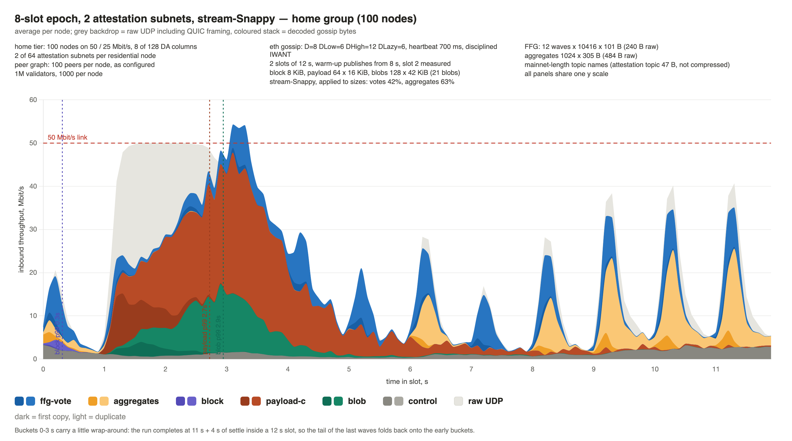
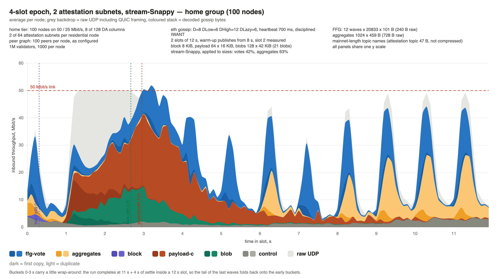
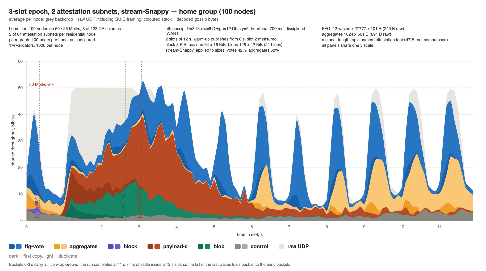
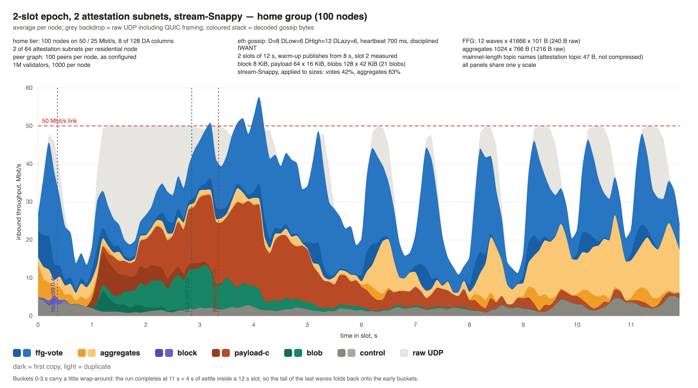
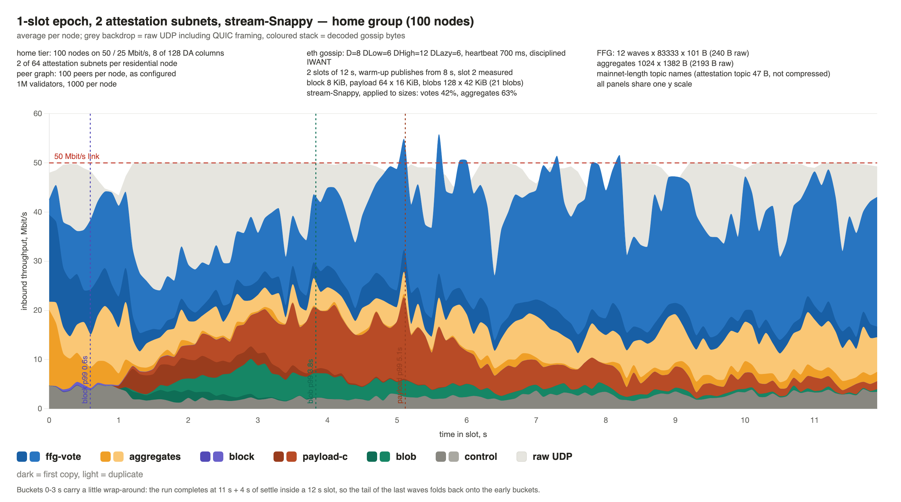
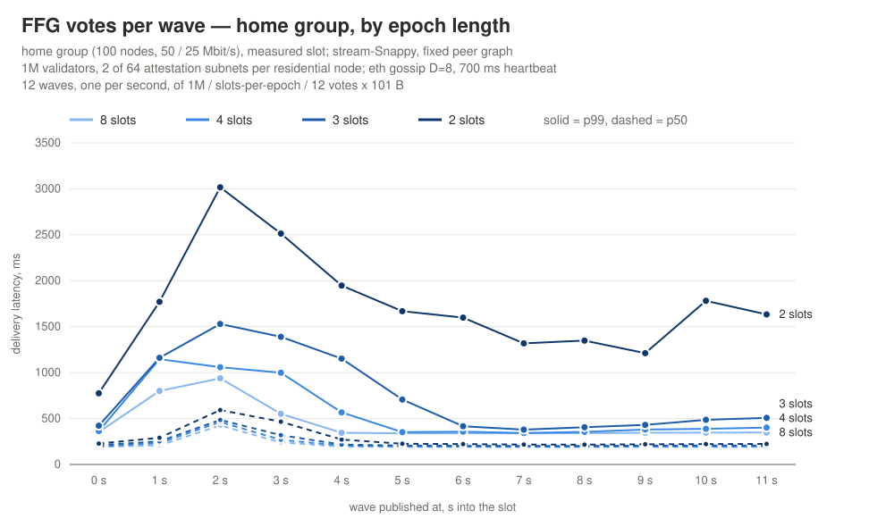
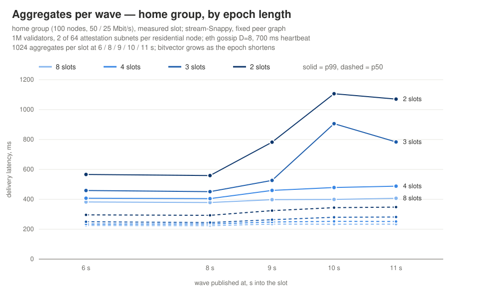

# DC gossip traffic profile: the epoch-length ceiling with stream-Snappy

The third note in the series, after [Gossip traffic profile for a slot](dc-slot-traffic-writeup.md)
and [the peer-count fix](dc-slot-traffic-followup.md). Every run here has
[stream-Snappy](https://ethresear.ch/t/snappy-with-a-memory-40-less-gossip-traffic/26078/2) and the fixed
peer graph, and residential nodes subscribe to **2 attestation subnets**. The epoch is shortened step
by step, **8 → 4 → 3 → 2 → 1 slots**, to find where a 50 / 25 Mbit/s node stops coping.

Note: this note was mostly composed by Claude.

## TL;DR

- **The ceiling is a 3-slot epoch.** 8, 4 and 3 slots fit; 2 slots still delivers, but not well;
  1 slot breaks down.
- **8 and 4 slots fit with room to spare.** The home link clears the bulk-data burst by ~4 s, and
  every vote wave after it has p99 under 570 ms.
- **3 slots fits without margin.** FFG p99 is 1068 ms, the worst wave 1.5 s, and the late aggregates
  reach 800–900 ms. But the link still drains between the waves, and from 6 s on the vote tail is back at
  380–510 ms.
- **2 slots is past the comfortable range.** The home link stays saturated until 5.5 s, then
  reaches its ceiling on every later wave. Every wave's p99 stays above 1.2 s, and a few
  hundredths of a percent of the last waves' deliveries are still missing when the run ends.
- **1 slot does not work.** The home link is saturated for 101 of the slot's 120 buckets. The
  *median* vote takes a second to reach a home node, p99 is 6.5 s, and 1.6% of all vote deliveries
  are still missing when the run ends.
- **The tail everyone sees comes from votes the 50 / 25 Mbit/s nodes publish.** At 2 slots the
  10 Gbit/s pools have an FFG p99 of 1753 ms. With the home tier only relaying, the same run gives
  them 286 ms, as at 8 slots. What is left at 2 slots is the home tier's own saturated downlink.

## Result

| | slots per epoch | attestation subnets |
|---|---|---|
| ✅ | 8 | 2 |
| ✅ | 4 | 2 |
| ✅ | 3 | 2 |
| ⚠️ | 2 | 2 |
| ❌ | 1 | 2 |

The criteria are the write-up's: the link should not stay saturated, and the vote tail should not
run away from the median, judged on the worst of the twelve waves.

Home tier (50 / 25 Mbit/s), measured slot:

| slots per epoch | 8 | 4 | 3 | 2 | 1 |
|---|---|---|---|---|---|
| votes per slot | 125 k | 250 k | 333 k | 500 k | 1 M |
| inbound UDP | 29.0 MB | 37.8 MB | 43.8 MB | 54.5 MB | 73.4 MB |
| 100 ms buckets ≥ 95% of the link | 15 | 21 | 31 | 47 | 101 |
| FFG p50 / p99, ms | 207 / 628 | 216 / 779 | 224 / 1068 | 251 / 1943 | 987 / 6453 |
| FFG worst wave p99, ms | 938 | 1146 | 1529 | 3016 | 9630 |
| aggregates p99, ms | 397 | 466 | 697 | 1001 | 4806 |
| aggregates worst wave p99, ms | 407 | 488 | 906 | 1106 | 4929 |
| payload chunks p99, ms | 1721 | 1954 | 2069 | 2348 | 4118 |
| blob columns p99, ms | 1944 | 1668 | 1645 | 1851 | 2833 |

### The home node's slot

Inbound throughput per node, averaged over the 100 nodes of the 50 / 25 Mbit/s group, in 100 ms
buckets across the measured slot. All panels are on one y scale.

**8-slot epoch.**

**4-slot epoch.**

**3-slot epoch.**

**2-slot epoch.**

**1-slot epoch.**

All five panels carry the same bulk data. In the first four the link is pinned from 1.2 s to ~3 s. What changes with the epoch length is how much vote traffic lands on top of it and after it.

- **8 and 4 slots** clear the burst by ~4 s. The waves after it peak at 30–45 Mbit/s and the link
  drains between them.
- **3 slots** clears it by ~4.5 s. The later waves touch the 50 Mbit/s line at their peaks but still
  drain to ~10 Mbit/s in between, so each wave starts on an empty queue.
- **2 slots** never drains. The link stays pinned until ~5.5 s, and from 6 s on every vote and
  aggregate wave reaches the ceiling, with only 15–30 Mbit/s between them. Each wave queues behind
  the last.
- **1 slot** has no structure left. The link is full for the whole slot, votes are more than half
  (56%) of the gossip bytes the home node receives, and the previous slot's tail runs into the next. Payload
  chunks take until 5.1 s at p99, and blobs until 3.8 s.

## Per-wave latency

Home tier, p50 and p99 of each wave. Hover a point for its value. The 1-slot epoch is left out of
these charts: its worst wave has p99 9.6 s and would flatten the other four lines. It is in the
tables above and below.

In every configuration the worst vote waves are the ones published into the bulk-data window at
1–3 s. What separates them is the recovery.

- **8 and 4 slots** are back at 340–400 ms p99 by the 4–5 s wave, and aggregates stay flat across the
  slot.
- **3 slots** takes one wave longer to recover, and from 6 s on its tail sits at 380–510 ms. Its late
  aggregates reach 800–900 ms. This is the last configuration that passes the criteria, and it does
  so without margin.
- **2 slots** never recovers: every wave from 1 s to 11 s has p99 above 1.2 s, and aggregates reach
  1.1 s. When the run ends, a few hundredths of a percent of the deliveries for the 9–11 s waves
  are still missing on every tier. Votes still get through, and the median stays near 220 ms, but
  the tail never comes back down.

## The tail comes from the constrained publishers

FFG latency by tier, p90 / p99 in ms:

| slots per epoch | `home` 50/25 | `mid-home` | `upper-home` | `vps` 500M | `validator-pools` 10G |
|---|---|---|---|---|---|
| 8 | 339 / 628 | 306 / 388 | 305 / 375 | 306 / 375 | 231 / 286 |
| 4 | 384 / 779 | 309 / 510 | 308 / 517 | 308 / 488 | 235 / 373 |
| 3 | 444 / 1068 | 320 / 791 | 316 / 840 | 315 / 785 | 239 / 741 |
| 2 | 701 / 1943 | 339 / 1816 | 336 / 1895 | 333 / 1812 | 260 / **1753** |
| 1 | 2624 / 6453 | 471 / 5618 | 381 / 5843 | 365 / 5588 | 303 / 5651 |

Two things grow as the epoch shortens. At 1 slot both have run away, and the pools' p95 is 1.46 s
as well.

- **Every tier's p99, but not its p90.** At the pools, p90 moves from 231 to 260 ms across the
  whole sweep while p99 goes from 286 to 1753 ms. If the network as a whole were congested, p90
  would rise with p99. Only the slowest ~5–10% of votes are slow, and every group hosts the same
  number of validators, so the 50 / 25 Mbit/s nodes publish about 10% of all votes.
  This is the mechanism the [original write-up](dc-slot-traffic-writeup.md) measured. A vote
  published from a 25 Mbit/s uplink waits behind that node's own relaying before its first hop,
  and mesh redundancy cannot route around the publisher. There, making the home tier relay-only
  took the pools' FFG p99 from 1592 to 281 ms with the same traffic. Shorter epochs and a second
  subnet make that queue longer, since a home node relays more votes per wave.
- **The home tier's own p90.** It rises from 339 to 701 ms, while the other tiers stay at 305–339 ms.
  That is the home node's downlink being saturated (47 saturated buckets at 2 slots), and it adds to
  what the home tier receives. It does not slow anyone else.

**Checked at 2 slots.** The same run was repeated with the 50 / 25 Mbit/s tier only relaying
(`-Ddc.homeValidators=false`). Its validators are spread over the other groups, so the network keeps
1M validators and every wave keeps its size. FFG p99, ms:

| | `home` 50/25 | `mid-home` | `upper-home` | `vps` 500M | `validator-pools` 10G |
|---|---|---|---|---|---|
| home tier publishes | 1943 | 1816 | 1895 | 1812 | 1753 |
| home tier relay-only | **1163** | **393** | **368** | **365** | **286** |

Every other tier's tail falls back to where it was at 8 slots. Aggregate p99 at the pools goes from
954 to 339 ms, and every vote is delivered. The home tier itself still has 47 saturated buckets
and an FFG p99 of 1163 ms. That part is its own downlink, and it is what still marks 2 slots as ⚠️
for a 50 / 25 Mbit/s node.

So the network-wide part of the tail is not a capacity limit of the network. It is a publishing
problem at the constrained tier. That points at a publisher-side fix, not yet tested here: let a
node's own messages go out ahead of what it relays.

## How it is modelled

- **Stream-Snappy is applied to sizes, not run.** Votes go on the wire at 42% of their size
  (240 → 101 B) and aggregates at 63%. These are the 64 KiB-history figures measured on a mainnet
  recording in the ethresear.ch post. Blocks, payload and blob columns are left as they are; they
  barely compress (93% / 96%).
- **Topic strings are not compressed.** The stream would shrink the 47-byte attestation topic to a
  few-byte back-reference. Here it stays at full size in every copy, so the vote figures are
  slightly pessimistic.
- **The warm-up slot is short**, as in the write-up: it publishes only from 8 s, so it carries votes
  and aggregates but no bulk data. A full warm-up slot, checked on the 4-slot epoch with 1 subnet,
  gives the home tier FFG p99 of 724 ms against 822 ms, the same aggregates (411 vs 413 ms), and blob
  columns of 1391 ms against 1733 ms. The short warm-up therefore reads somewhat pessimistic,
  mostly on blobs. Raising QUIC's initial congestion window instead does not reproduce a full
  warm-up. With 32 packets the home links never shed their window (38 KB against 15 KB warm), and
  FFG p99 came out worse than with either warm-up.

## Run parameters

- 1M validators; 1000 nodes in five groups: 100 pools with 200 peers, 600 VPS, and 100 each of
  upper-, mid- and 50 / 25 Mbit/s home, with 100 peers each. Fixed peer graph.
- Residential tiers subscribe to **2 of 64** attestation subnets. VPS nodes subscribe to 4, pools to all.
- 2 slots of 12 s; the warm-up slot publishes from 8 s; slot 2 measured.
- eth gossip: D=8, DLow=6, DHigh=12, DLazy=6, heartbeat 700 ms; disciplined IWANT on the home tier.
- Block 8 KiB; payload 64 × 16 KiB; blobs 128 × 42 KiB (21 blobs); mainnet-length topic names.
- FFG: 12 waves, one per second, of 1M / slots-per-epoch / 12 votes, 101 B each.
- Aggregates: 1024 per slot, published at 6, 8, 9, 10 and 11 s. The bitvector covers one slot's
  share of a subnet, so it grows as the epoch shortens:

  | slots per epoch | votes per wave | aggregate, raw | aggregate, on the wire |
  |---|---|---|---|
  | 8 | 10 416 | 484 B | 305 B |
  | 4 | 20 833 | 728 B | 459 B |
  | 3 | 27 777 | 891 B | 561 B |
  | 2 | 41 666 | 1216 B | 766 B |
  | 1 | 83 333 | 2193 B | 1382 B |

- `-Ddc.snappyStream=true -Ddc.homeFfgSubnets=2 -Ddc.ffgSlots=N` in
  `DcScenarioRunnerTest.large network`.
