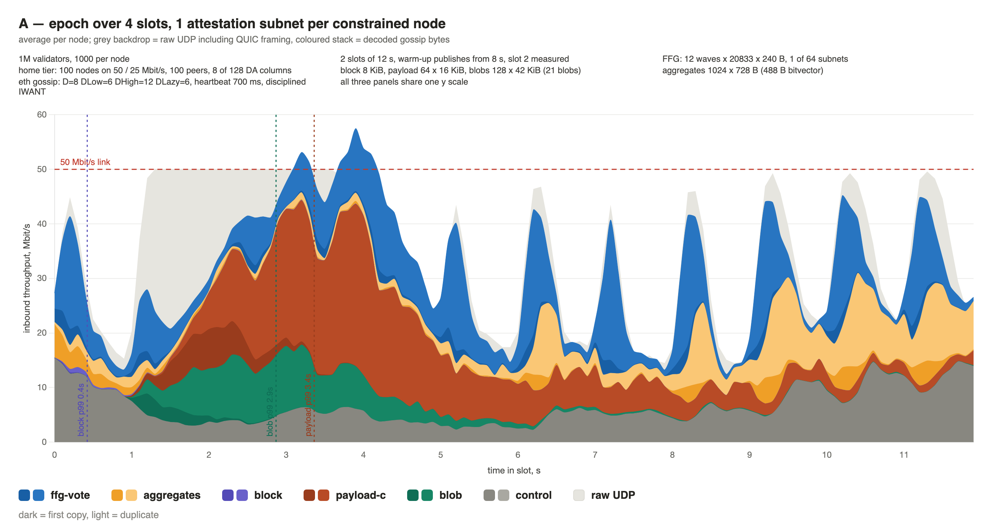
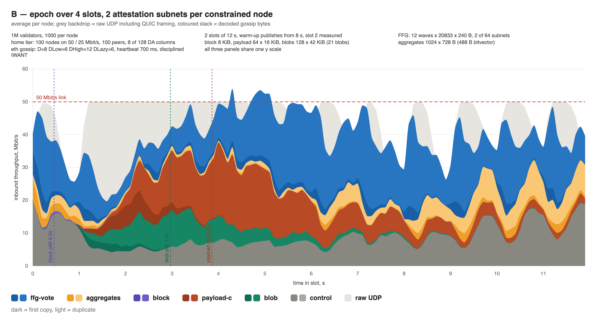
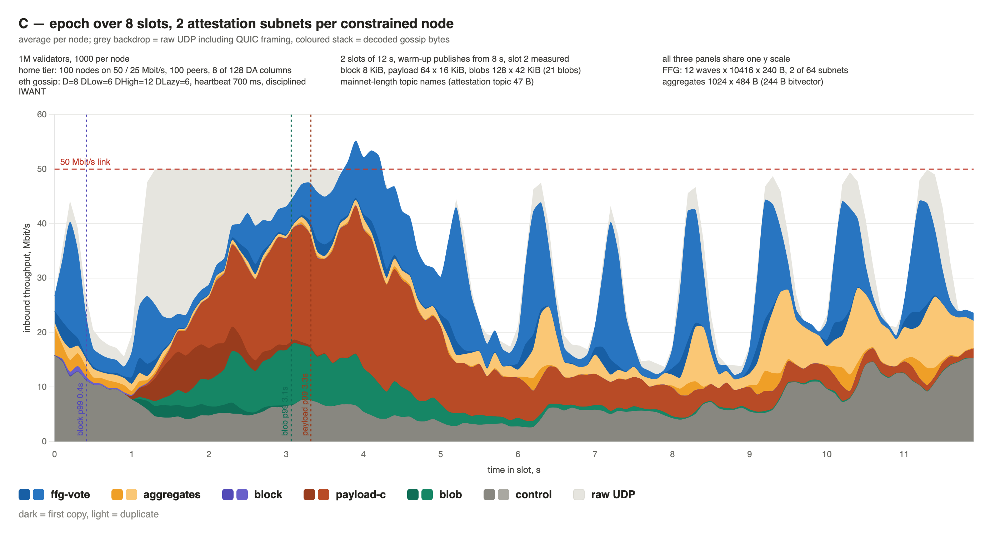
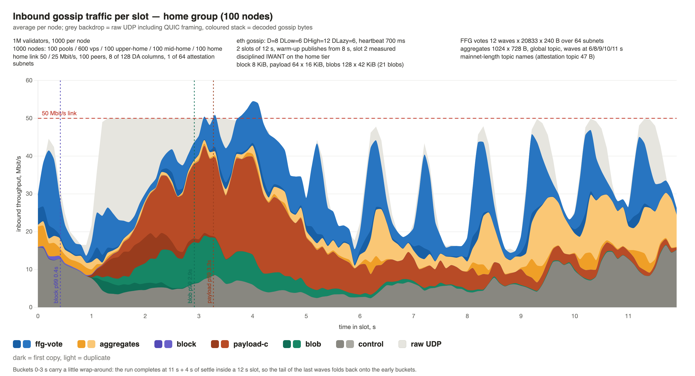
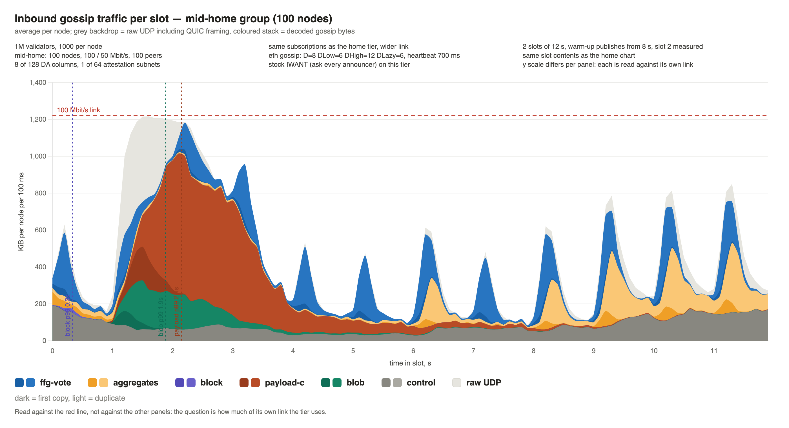
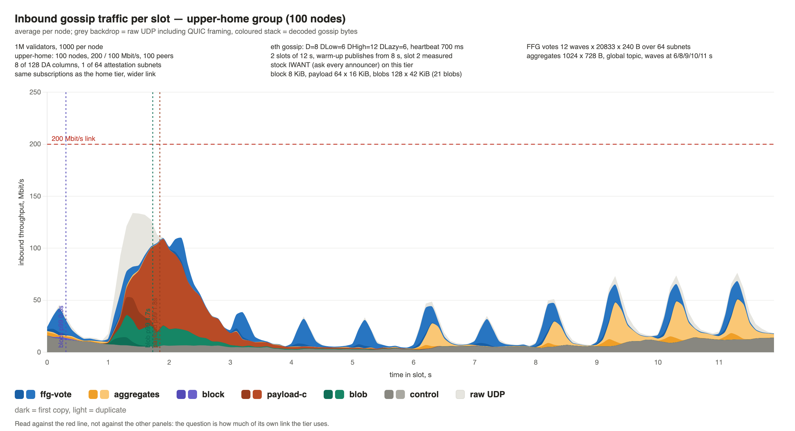
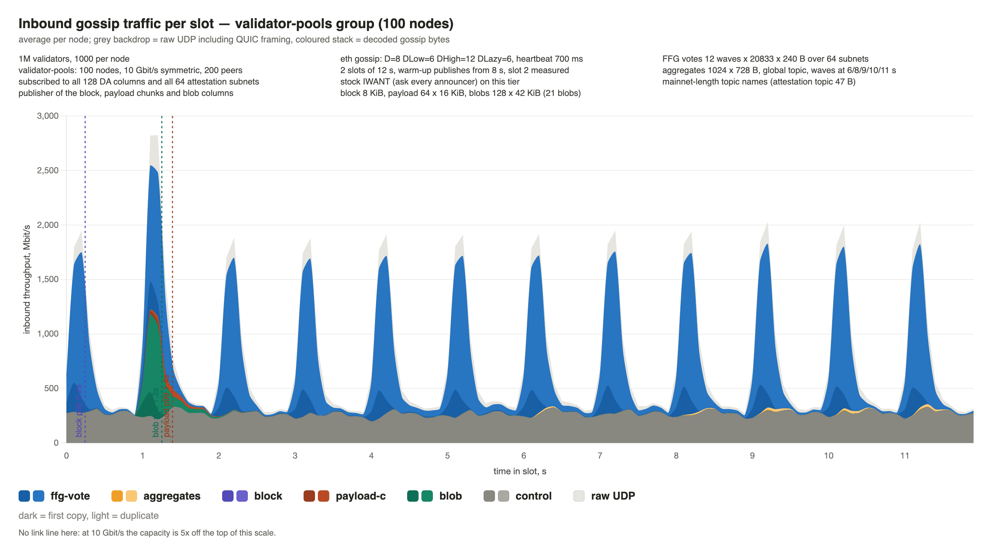

# Distributed Consensus: Gossip traffic profile for a slot

Fast-finality designs move a lot more attestation and aggregate traffic than today's network, and
that traffic is not spread evenly: a slot has a bulk-data burst at its start and a dozen attestation
waves on top of it. This write-up shows what a slot actually looks like on the wire — how the bytes
are distributed in time, how they split per message type and per class of node, and whether
attestations and aggregates make their deadlines on a home-grade link.

<b>The subject is the most constrained node in the network</b> — the 50 / 25 Mbit/s home tier, not
the average node.

The network is a mix of tiers, from 10 Gbit/s staking operators down to a 50 / 25 Mbit/s home
connection, and the question that decides whether a parameter set is viable is not what the average
node sees — it is whether the *most constrained* node still receives everything in time. That node
has the narrowest link, and it is also the one whose failure is least acceptable: home stakers are
the population the protocol is supposed to keep in.

So the profile below is read on the `home` tier first, and everything better provisioned is expected
to have an easier time of it — it carries the same messages over a link that is 2× to 200× wider,
which the comparison further down confirms for bulk data and, interestingly, does not confirm for
the attestation tail. The pool chart is included only as the other extreme, to show what changes
when a node subscribes to everything.

One condition on all of this is load-bearing and is spelled out in its own section below:
constrained nodes have to be a *minority* surrounded by better-provisioned peers. A network made
entirely of them is a different network, and a much slower one.

Everything below comes from the `large network` scenario in
[`DcScenarioRunnerTest`](examples/dc/src/test/kotlin/playground/DcScenarioRunnerTest.kt), run on
the simulator in `examples/dc`.

## Result: the slot fits, in two of the three configurations

**A fast-finality slot — a block, a 1 MiB payload, 21 blobs' worth of DA columns, 250 000 FFG votes
and 1024 aggregates — fits on a 50 / 25 Mbit/s node.** It does not fit unconditionally: the
configuration has to trade off how many attestation subnets a constrained node carries against how
many slots the epoch spreads its votes over.

Two things have to hold for a configuration to count as working:

- **Every attestation wave arrives within 4 s of being published** — judged on the *worst* wave of
  the twelve, not on the average. A vote that misses its deadline is not a vote.
- **The link is not pinned to its ceiling for most of the slot.** A node that spends the whole slot
  at 100% has no headroom left for a bad slot, a re-org or a peer churn event.

Three configurations were run, identical in everything else:

| home tier, per measured slot | **A** — 4-slot epoch, 1 subnet | **B** — 4-slot epoch, 2 subnets | **C** — 8-slot epoch, 2 subnets |
|---|---|---|---|
| inbound, raw UDP | 52.2 MB | 66.4 MB | **50.2 MB** |
| link at ≥ 95% of 50 Mbit/s | 3.4 s of 12 | **6.9 s of 12** | 3.2 s of 12 |
| FFG p99, worst wave | 3.15 s | **4.06 s** | **2.13 s** |
| FFG p99, all waves | 2.07 s | 3.03 s | 1.39 s |
| aggregate p99, worst wave | 1.18 s | 1.29 s | 1.07 s |
| payload chunk p99 | 2.36 s | 2.86 s | 2.24 s |
| | **fits**, 0.85 s of margin | **misses the deadline** | **fits**, 1.87 s of margin |

**A — 4-slot epoch, one attestation subnet.** The bulk-data burst pins the link for 3.4 s, the
twelve vote waves ride on top of it, and the worst wave lands 0.85 s inside the deadline.

**B — the same epoch, two subnets.** Doubling the vote traffic a constrained node carries adds 27%
to its inbound bytes, and the slot stops draining: the link is at its ceiling for 6.9 of 12 seconds,
the blue vote band never clears between waves, and the worst wave **misses the 4 s deadline at
4.06 s**. Everything still arrives — just not in time.

**C — two subnets, epoch spread over 8 slots.** Spreading the epoch halves both quantities the
second subnet doubled: 10 416 votes per wave instead of 20 833, and a 484-byte aggregate instead of
728, since the bitvector covers half as much of a subnet. That buys back more than the second subnet
cost — **C is the best of the three on every row**, including the baseline it is being compared to.

So there are two working configurations, and the lever that separates them is not bandwidth:

> **Epoch length is what pays for attestation subnets.** A constrained node can carry a second
> attestation subnet if, and only if, the epoch is stretched to match.

Why C's tail is better when its local traffic profile is identical — the attestation tail
belongs to the network, not to the receiving node

A and C put **the same vote load on a constrained node**, by construction: the second subnet doubles
its share, the longer epoch halves the votes per slot, and the two cancel.

| per home node, measured slot | A | C |
|---|---|---|
| ffg-vote bytes | 12.4 MB | 12.1 MB |
| votes received per wave | ~325 | ~326 |

What is *not* the same is what the rest of the network carries. Each validator attests once per
epoch, so an 8-slot epoch puts 125 000 votes in a slot where a 4-slot epoch puts 250 000:

| per node, measured slot | A | C |
|---|---|---|
| `vps` — total / of it votes | 96.7 MB / 41.5 | 63.0 MB / 20.5 |
| `validator-pools` — total / of it votes | 1052 MB / 503.7 | 563 MB / 249.8 |

And that is where the tail is made. Within a single run, **FFG p99 is nearly the same for every
tier**, from the 50 Mbit/s home node to the 10 Gbit/s pool node running at 23% utilisation:

| FFG p99, ms | `home` 50/25 | `mid-home` | `upper-home` | `vps` 500M | `validator-pools` 10G |
|---|---|---|---|---|---|
| **A** | 2073 | 1872 | 1950 | 1780 | **1742** |
| **B** | 3034 | 2670 | 2756 | 2648 | **2598** |
| **C** | 1386 | 1285 | 1344 | 1275 | **1226** |

A tail caused by the receiver's own congestion could not be the same number for a node on 50 Mbit/s
and a node on 10 Gbit/s. The tail moves with the *total* vote volume in the network — halve it and
every tier's p99 falls by a third — while p50 barely moves (203 → 192 ms on the home tier). The
typical path is equally fast in both; what differs is the unlucky path, the one that queues behind
somebody else's forwarding burst, and in A every burst is twice as deep everywhere.

B proves the same point from the other side. Only the *constrained tier's* subscription changed
there — nothing about the pools, the vps or the epoch — and yet **every tier's tail got worse,
including the pools' (1742 → 2598 ms)**. Constrained nodes sit in everyone's meshes and relay for
everyone, so congesting them congests the network: they are not just the tier that suffers first,
they are a term in everybody else's latency.

Per-wave comparison: FFG votes and aggregates, A / B / C

All figures home tier, measured slot, milliseconds.

**FFG votes — 12 waves, one per second.** A and C publish a wave every second either way; C's waves
are half the size (10 416 votes against 20 833), B's are the same size as A's but arrive on two
subnets instead of one.

| wave @ | A p50 | A p99 | B p50 | B p99 | C p50 | C p99 |
|---|---|---|---|---|---|---|
| 0 s | 214 | 853 | 243 | 3486 | 204 | 492 |
| 1 s | 233 | 2820 | 263 | **4063** | 210 | 1068 |
| 2 s | 620 | **3149** | 741 | 3984 | 599 | **2132** |
| 3 s | 531 | 2437 | 914 | 3138 | 511 | 1831 |
| 4 s | 257 | 1805 | 782 | 2651 | 238 | 1489 |
| 5 s | 210 | 1470 | 499 | 2203 | 206 | 1154 |
| 6 s | 206 | 1422 | 282 | 1985 | 199 | 1014 |
| 7 s | 206 | 1160 | 249 | 1829 | 194 | 491 |
| 8 s | 203 | 1281 | 229 | 1764 | 192 | 490 |
| 9 s | 201 | 1257 | 230 | 1955 | 192 | 425 |
| 10 s | 207 | 1337 | 233 | 2028 | 195 | 444 |
| 11 s | 209 | 1356 | 235 | 1894 | 201 | 489 |
| **all waves** | **234** | **2073** | **355** | **3034** | **224** | **1386** |

**Aggregates — 5 publication instants.** Same 1024 aggregates per slot in all three; in C each one
is 484 B rather than 728 B, because its bitvector covers half a slot's share of a subnet.

| wave @ | A p50 | A p99 | B p50 | B p99 | C p50 | C p99 |
|---|---|---|---|---|---|---|
| 6 s | 286 | 582 | 412 | 1135 | 281 | 490 |
| 8 s | 285 | 494 | 372 | 907 | 276 | 475 |
| 9 s | 306 | 625 | 428 | 1034 | 291 | 590 |
| 10 s | 326 | 962 | 464 | 1240 | 306 | 948 |
| 11 s | 336 | **1181** | 490 | **1291** | 315 | **1074** |
| **all waves** | **310** | **971** | **438** | **1201** | **296** | **849** |

Two things the aggregate table shows that the FFG one does not. Aggregates are published after the
bulk-data burst is gone, so no configuration has a catastrophic wave — B's worst is 1.29 s, not 4 s.
But they **degrade monotonically across the slot** in all three, 582 → 1181 ms in A, because each
later wave queues behind more accumulated vote traffic. That is the one place where B's extra load
shows up as a constant penalty rather than a burst effect: its p50 is 90–155 ms worse than A's in every
single wave, from the first one onwards.

In every configuration the worst FFG waves are those published into the bulk-data window at 1–3 s,
and what separates the three is how quickly the network gets out from under it. A is back under 1.5 s
from wave 5 on, C under 500 ms from wave 7 on. B never recovers: its cheapest wave — at 8 s, as far
from the burst as a wave gets — is still 1.76 s, worse than *any* wave A sees once the burst has
cleared.

That also says where the remaining headroom is: the constraint is not the steady-state vote rate but
the collision between the votes and the DA burst at the head of the slot.

## Experiment parameters

### Simulator

The nodes are real: unmodified jvm-libp2p gossipsub with its real Netty pipelines and a simulated
QUIC transport. What is simulated is time and the network underneath:

- **1000 nodes**, each behind a modelled access link with separate download and upload capacity.
- **Six regions** (US-East, US-West, Europe, Asia, South America, Africa) with a fixed RTT matrix —
  15–30 ms intra-region, up to 250 ms between the far pairs.
- **Queueing**: `SHADOW_LIKE` — FIFO shaping on a node's egress link, CoDel on the router→host
  ingress link, so a saturated downlink drops rather than buffers without bound.
- **Peer graph**: 100 peers per node (200 for the pools), built so every node has at least 8 peers
  in every subnet it subscribes to.
- **Measurement**: every simulated UDP datagram is folded into 100 ms buckets per node; gossip RPCs
  are counted after decoding, split by message type, by unique-vs-duplicate, and with a control
  breakdown (IHAVE / IWANT / IDONTWANT / GRAFT / PRUNE / subscriptions).

### Node population

1M validators, 1000 validators per node, five groups:

| group | nodes | link (down/up) | peers | DA columns | attestation subnets |
|---|---|---|---|---|---|
| `validator-pools` | 100 | 10 Gbit/s symmetric | 200 | all 128 | all 64 |
| `vps` | 600 | 500 Mbit/s symmetric | 100 | 16 of 128 | 4 of 64 |
| `upper-home` | 100 | 200 / 100 Mbit/s | 100 | 8 of 128 | 1 of 64 |
| `mid-home` | 100 | 100 / 50 Mbit/s | 100 | 8 of 128 | 1 of 64 |
| `home` | 100 | **50 / 25 Mbit/s** | 100 | 8 of 128 | 1 of 64 |

The `home` tier is the EIP-7870 "Attester" floor — 50 Mbit/s down, 25 Mbit/s up — and it is the
group everything below is read against, for the reason given above: it is the tier that decides
whether the configuration works. `mid-home` and `upper-home` are the same node with 2× and 4× the
link, and they are there to separate what a wider link fixes from what it does not.

The pools are the only publishers of blocks, payload chunks and blob columns; attestations and
aggregates are published by validators drawn from every group.

### The load-bearing assumption: constrained nodes are a minority

Everything in this write-up holds <b>only because the 50 / 25 Mbit/s nodes are 10% of the network
and are surrounded by much better-provisioned peers.</b> This is a condition on the network, not a
detail of the scenario, and it is worth stating plainly because the conclusions do not survive
without it.

Gossip forwarding is byte-symmetric: a node receives each message it subscribes to about `mesh`
times and forwards it about `mesh − 1` times, so upload and download are nearly the same quantity.
This run measures exactly that — a home node sends 72.3 MB and receives 75.6 MB, a ratio of 0.96.
But the attester link is 2:1 asymmetric, so a home node has only half the upload it would need to
carry its own weight. **It is a net sink**, and a network can only absorb sinks while they are a
minority: here, a home node's ~100 peers are drawn overwhelmingly from the 700 nodes on 500 Mbit/s
or more, which can serve it at full rate and can re-forward what it forwards slowly.

**If the whole network were on 50 / 25, the network's effective capacity would be the 25 Mbit/s
uplink, not the 50 Mbit/s downlink** — nobody can deliver faster than their peers can send. The
slot measured here already averages ~35 Mbit/s of inbound raw UDP per home node (52.2 MB over 12 s)
and peaks at 100% of the downlink; there is no arrangement in which every node also *uploads* that
much over a 25 Mbit/s link. The traffic simply does not fit, and the numbers below would not carry
over.

How much worse a homogeneous network actually gets is **not measured here**. Earlier runs of a
1000-node all-home network exist, but they predate the pull discipline this configuration relies on,
so their degradation cannot be separated from the IWANT amplification that has since been fixed.
The direction is not in doubt — the uplink bound above is arithmetic — but the magnitude needs a
fresh run before it is worth quoting.

So the claim this write-up supports is "a minimum-spec node survives a fast-finality slot **in a
mixed network**", not "a network of minimum-spec nodes survives one". The composition of the
population is itself a parameter, and one the protocol specifications say little about: EIP-7870
defines the attester tier as a per-node floor and makes no assumption about how many nodes sit on
it.

### Gossip

A constraint that shaped all of this: the protocol itself is not changed

 Everything here is an
implementation change — local behaviour, local policy, an extra knob in `GossipParams` — and none
of it touches the wire format, the control message types, their semantics, or what a peer is
entitled to expect. Nothing needs to be negotiated and nothing needs a spec change: a node running
these changes talks to a stock gossipsub peer, and every choice below is one a node makes for
itself. Batching several messages into one RPC is something the format already allows; whether and
when to answer an IHAVE with an IWANT is the receiver's own decision; remembering which ids you
already advertised to a peer is bookkeeping, not protocol. The mesh degree is local in the same
way, which is why the tiers here can run different values of `D` and still interoperate.

#### Parameters

Ethereum mainnet values — `D` = 8

**Ethereum mainnet values — `D` = 8, `D_low` = 6, `D_high` = 12, `D_lazy` = 6, heartbeat 700 ms —
not jvm-libp2p's defaults.** Measured mesh: 9.47 per (node, topic) network-wide, 11.67 on the home
tier.

| | value | jvm-libp2p default |
|---|---|---|
| `D` / `D_low` / `D_high` / `D_lazy` | 8 / 6 / 12 / 6 | 6 / 4 / 12 / 6 |
| heartbeat interval | 700 ms | 1000 ms |
| IWANT policy on the `home` tier | **disciplined** | ask every announcer |
| IWANT policy elsewhere | ask every announcer | ask every announcer |

Message ids are content-only (no `from` / `seqno` / `signature`), as on mainnet, so duplicates are
recognised as duplicates.

`D = 8` instead of 6 raises duplication by about a third, and a 700 ms heartbeat fires gossip
emission 43% more often than a 1000 ms one, which matters because IHAVE dominates control traffic.
So a run against jvm-libp2p defaults is optimistic relative to mainnet, not conservative.

#### Modifications

Batch publishing

Modification investigated by @csaba

Messages handled in one event-loop turn
leave as one merged RPC per peer, not one RPC each

A router that handles one message at a time emits one RPC per message per peer, which in this
scenario would be fatal to realism: a slot carries 250 000 FFG votes of 240 bytes, each arriving in
its own framed RPC with its own write.

The router takes lists instead. `publishBatch()` publishes a list atomically on one event-loop
turn, and on the receive side every message decoded from one inbound RPC that validates
synchronously is broadcast in a single chunk (`broadcastInbound(msgs, peer)`) followed by one
`flushAllPending()`. Everything accumulated in a peer's `RpcPartsQueue` during that turn leaves as
one merged RPC, sized against the RPC limits. A node that receives 30 votes in one frame forwards
them in one frame, not thirty.

Disciplined IWANT

Modification investigated by @csaba

Ask one announcer at a time instead of every announcer; cuts
home-tier inbound traffic by a third and FFG p99 from 5.1 s to 1.6 s

`GossipParams.iWantPolicy`, commits `304d4ad0` and `9949de48`.

Stock gossipsub answers an IHAVE for an unknown message id by immediately sending IWANT to *that*
announcer, with no check for a request already in flight. A node whose mesh delivery runs late
therefore gets one extra copy for every IHAVE that beats the message. On the home tier this was the
single largest source of traffic: 22.4 copies of each payload chunk against a mesh of 11.7.

The disciplined policy keeps an offer table per message id, asks **one** announcer at a time,
retries after 200 ms, penalises a broken promise for 400 ms and parks a dead id for 30 s. Measured
on this scenario (single-slot runs, home tier):

| home tier | ask every announcer | disciplined |
|---|---|---|
| IWANT ids sent per node | 82 870 | **1 480** |
| copies per payload chunk | 22.8 | **12.3** |
| inbound per node | 82.6 MB | **56.4 MB** |
| FFG vote p99 | 5.10 s | **1.61 s** |
| aggregate p99 | 5.35 s | **0.99 s** |

Note what this is *not*: shrinking the mesh does not substitute for it. At `D = 4 / D_high = 4` the
mesh fell from 11.7 to 3.9 while copies per chunk only went 22.4 → 18.3, because a leaner mesh
delivers later and lets *more* IHAVEs win the race.

#### Bug fixed along the way

Duplicate IHAVE — the same message id was advertised to the same peer more than
once, because <code>emitGossip</code> kept no record of who had been told

Commit `6ae0e236`.

`emitGossip` built one id list per topic and sent it to every selected peer with no memory of who
had already been told, so the same message id was re-advertised to the same peer on subsequent
heartbeats, and twice inside a single RPC for a message carrying two topic ids.

The mcache now tracks `wasGossipedTo` per peer, and the `maxIHaveLength` cut is applied *after*
that filter — so a peer that already knows the first 5000 ids receives the next batch rather than
the same one. Regression tests were written first; all three failed against the old code.

### What a slot publishes

| message | size | per slot | published at | topics |
|---|---|---|---|---|
| block | 8 KiB | 1 | 0 s | global |
| payload chunks | 16 KiB | 64 (1 MiB) | 1 s | 64 subnets |
| blob columns | 42 KiB | 128 (5.25 MiB, = 21 blobs) | 1 s | 128 subnets |
| FFG votes | 240 B | 12 waves × 20 833 = 250 k (60 MB) | 0 s … 11 s, one wave per second | 64 subnets |
| aggregates | 728 B | 1024 (0.75 MB) | 6 s, 8 s, 9 s, 10 s, 11 s | global |

Notes on the two attestation rows, which are the fast-finality-specific part:

- Each validator attests **once per epoch**, and the epoch is spread over **4 slots**, so a slot
  carries a quarter of 1M votes — 250 k votes, published in 12 waves of 20 833, one per second.
- An aggregate covers one slot's share of one subnet: a 488-byte bitvector
  (1M / 64 subnets / 4 slots / 8) plus a 240-byte attestation body = **728 B**. 64 aggregates per
  wave, one per subnet, 16 waves folded into the 5 publication instants above.
- By byte count the slot is **~60 MB of votes against ~6 MB of bulk data** published network-wide —
  the inversion that makes this traffic profile worth looking at at all.

### Run protocol

- **2 slots of 12 s**; slot 0 is warm-up and excluded, all figures describe **slot 1**.
- The warm-up slot publishes only its **last 4 seconds** (`dc.warmupFrom=8`). A measured slot needs
  a predecessor — a cold slot reads ffg p99 at 1.61 s instead of 2.12 s and blob p50 at 787 ms
  instead of 492 ms — but a *full* warm-up slot costs as much wall clock as the measured one and
  changes the result by only a few percent, except for inflating the bulk-data tail the measured
  slot inherits.
- Run on the 512 GB Mac Studio: **24 m 27 s of wall clock for 42 s of simulated time**.
- Gossip bytes are 89.3% of raw UDP bytes in the measured slot, the rest being QUIC and framing
  overhead.

## Traffic profile

Inbound throughput per node, averaged over the group, in 100 ms buckets across the measured slot —
the y axis is Mbit/s, so a tier's link capacity is the number printed on its link. The
stack is decoded gossip, split per message type, with the first copy of a message in the darker
shade and its duplicates in the lighter one. The grey backdrop is raw UDP — the gap between it and
the stack is QUIC and framing overhead.

How close each tier comes to its own downlink, over the measured slot:

| group | link | peak throughput | peak as % of link | buckets ≥ 95% (of 120) |
|---|---|---|---|---|
| `validator-pools` | 10 Gbit/s | 2303 Mbit/s | 23.0% | 0 |
| `vps` | 500 Mbit/s | 237 Mbit/s | 47.4% | 0 |
| `upper-home` | 200 Mbit/s | 134 Mbit/s | 67.0% | 0 |
| `mid-home` | 100 Mbit/s | 99.7 Mbit/s | 99.7% | 9 |
| `home` | **50 Mbit/s** | 50.0 Mbit/s | **100%** | **34** |

Utilisation rises monotonically as the link narrows, and only the two home tiers touch their
ceiling — `home` for 3.4 s of the slot, `mid-home` for 0.9 s. Everything above them has headroom to
spare and is not what limits the configuration, which is why the rest of this section reads the
`home` profile in detail and uses the pool profile only as a contrast.

### Home tier (50 / 25 Mbit/s) — the binding case

This is the chart that matters: the most constrained node in the network, the one that saturates
first and the one the protocol is meant to keep in.

Per home node per slot: **52.2 MB of raw UDP, 46.4 MB of decoded gossip** (88.8%).

| | MB / node / slot | share of gossip bytes |
|---|---|---|
| payload chunks | 12.4 | 26.8% |
| FFG votes | 12.4 | 26.7% |
| aggregates | 7.6 | 16.4% |
| blob columns | 4.1 | 8.8% |
| block | 0.1 | 0.2% |
| control (87.5% IHAVE) | 9.8 | 21.1% |

**Duplicates are 70.4% of all gossip bytes** — mesh size is 11.67 and a node receives roughly that
many copies of everything it subscribes to.

The slot has three distinct phases:

1. **0 – 1 s.** The first attestation wave, the block, and a control burst at the slot boundary
   (~15 Mbit/s against a ~4 Mbit/s floor mid-slot) as the heartbeat fires.
2. **1 – 4.5 s: the bulk-data window.** Payload chunks and blob columns are published at +1 s and
   the link goes to **100% of its 50 Mbit/s downlink and stays there for 34 of the slot's 120
   buckets**. Blob columns finish first (p99 at 2.9 s), payload chunks last (p99 at 3.4 s) — the
   dotted verticals.
3. **4.5 – 12 s: the attestation sawtooth.** Once the bulk data drains, each of the twelve vote
   waves shows as a blue spike, with the aggregates (gold) joining from 6 s. The link is never
   saturated here.

Two reading notes:

- The stack can rise slightly *above* the grey backdrop and above the link line. That is not
  over-capacity traffic: raw UDP is credited the instant a datagram lands, while a gossip message
  is credited only when its last datagram has arrived and the RPC is decoded. A 43 KB blob column
  is ~36 datagrams, so the stack lags the grey while the queue is deep and repays the debt
  afterwards. Over the whole slot the ratio is a flat 88.8%.
- Buckets 0 – 3 s carry a small amount of wrap-around. The run's completion window is
  11 s + 4 s of settle in a 12 s slot, so the tail of the last waves folds back onto the early
  buckets. It inflates the early bands slightly; it does not affect the per-wave figures below.

### The same node on a wider link

`mid-home` and `upper-home` are the same node as `home` — same 8 DA columns, same single
attestation subnet, same 100 peers — with 2× and 4× the bandwidth. The three charts below are what
happens to the profile when only the link changes; the first one is the home profile again, repeated
here so the three can be read in sequence.

**50 / 25 Mbit/s — `home`** (the chart from above)

**100 / 50 Mbit/s — `mid-home`**

**200 / 100 Mbit/s — `upper-home`**

Each panel has its own y scale and its own red capacity line, so read every one against its own
line rather than against the others.

The bulk-data window is the part that moves. At 50 Mbit/s it is a 3.4-second plateau against the
ceiling; at 100 Mbit/s it is a peak that still just touches the line for 0.9 s; at 200 Mbit/s it is
a single spike that reaches 67% of the link and is over by 3 s, leaving the rest of the slot visibly
empty. What is left there is the attestation sawtooth, which costs the same on every tier.

| home group → | `home` 50/25 | `mid-home` 100/50 | `upper-home` 200/100 |
|---|---|---|---|
| peak use of own link | 100% | 99.7% | 67.0% |
| buckets ≥ 95% (of 120) | 34 | 9 | 0 |
| payload chunk p50 / p99 | 1094 / 2362 ms | 573 / 1143 ms | 461 / 845 ms |
| blob column p50 / p99 | 545 / 1868 ms | 330 / 883 ms | 303 / 729 ms |
| FFG vote p50 / p99 | 234 / 2073 ms | 203 / **1872** ms | 195 / **1950** ms |
| aggregate p50 / p99 | 310 / 971 ms | 269 / **954** ms | 264 / **953** ms |

Two things to take from this:

- **Bulk data scales with the link, as expected.** Doubling the link halves payload-chunk p99, and
  doubling it again takes off another third. A node above the home tier is never in trouble on
  blocks, payload or DA columns.
- **The attestation and aggregate tails do not.** FFG p99 barely moves (2073 → 1872 → 1950 ms) and
  the aggregate p99 is flat to the millisecond (971 → 954 → 953 ms). Those tails are not produced by
  the receiving node's downlink — they are produced by propagation through a mesh whose other
  members are home nodes. **A well-provisioned node cannot buy its way out of them**; they are a
  property of the population, which is the other half of why the most constrained tier is the one to
  design against.

### Validator pool (10 Gbit/s, all subnets)

The same slot seen by a node that subscribes to **all** 128 DA columns and **all** 64 attestation
subnets. Two things change completely:

- **Volume**: **1052 MB of raw UDP per node per slot**, 20× the home tier, of which 945 MB is
  decoded gossip.
- **Composition**: FFG votes are 504 MB (53%) because the node listens to all 64 subnets, and
  **control is 399 MB — 42% of its gossip bytes, 99.2% of it IHAVE** (24.2 M message ids announced
  per node over the run). On the home tier, which listens to one attestation subnet, the control
  column is 9.8 MB. IHAVE volume scales with the number of subnets a node subscribes to, and
  `maxIHaveLength` is applied per topic with no accounting across topics.

Bulk data is a rounding error here: payload chunks and blob columns together are 3.9% of what a
pool node receives, against 35.6% on the home tier.

## Attestation and aggregate waves

Per-wave latency, home group, measured slot.

### FFG votes — 12 waves, one per second

| wave | published at | p50 | p90 | p99 |
|---|---|---|---|---|
| 0 | 0 s | 214 ms | 365 ms | 853 ms |
| 1 | 1 s | 233 ms | 602 ms | **2820 ms** |
| 2 | 2 s | 620 ms | 1319 ms | **3149 ms** |
| 3 | 3 s | 531 ms | 1105 ms | **2437 ms** |
| 4 | 4 s | 257 ms | 761 ms | 1805 ms |
| 5 | 5 s | 210 ms | 533 ms | 1470 ms |
| 6 | 6 s | 206 ms | 393 ms | 1422 ms |
| 7 | 7 s | 206 ms | 354 ms | 1160 ms |
| 8 | 8 s | 203 ms | 349 ms | 1281 ms |
| 9 | 9 s | 201 ms | 364 ms | 1257 ms |
| 10 | 10 s | 207 ms | 372 ms | 1337 ms |
| 11 | 11 s | 209 ms | 382 ms | 1356 ms |
| **all** | | **234 ms** | **676 ms** | **2073 ms** |

Every wave carries the same 20 833 votes, so the spread is not about volume. **Waves 1–3 are the
ones published into the bulk-data window**, and they pay 2.4–3.1 s at p99 against 1.2–1.4 s for the
waves after it — and 620 ms at p50 for wave 2 against ~205 ms once the link is free. The
attestation tail on a home link is set by the blobs and the payload, not by the attestations.

All twelve waves stay under the 4 s attestation deadline, with ~850 ms of margin in the worst wave.

### Aggregates — 5 publication instants

| wave | published at | aggregates | p50 | p90 | p99 |
|---|---|---|---|---|---|
| 0 | 6 s | 128 | 286 ms | 410 ms | 582 ms |
| 1 | 8 s | 128 | 285 ms | 401 ms | 494 ms |
| 2 | 9 s | 256 | 306 ms | 472 ms | 625 ms |
| 3 | 10 s | 256 | 326 ms | 553 ms | 962 ms |
| 4 | 11 s | 256 | 336 ms | 588 ms | 1181 ms |
| **all** | | **1024** | **310 ms** | **500 ms** | **971 ms** |

Aggregates are published after the bulk data is gone, so they never compete with it — but they
degrade steadily across the slot, 582 ms → 1181 ms at p99, as each later wave queues behind more
accumulated vote traffic. They are also the most expensive message per byte published: 1024
aggregates of 728 B go to a **global** topic, so every node receives all of them, which is why
0.75 MB published becomes 7.6 MB inbound per home node — more than the blob columns.
