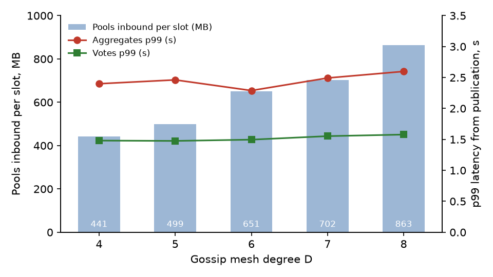

# Post-quantum attestations: gossip mesh degree D = 4 vs 8

Follow-up to [pq-gasper.md](pq-gasper.md). Same setup (variant A, full 2,404 B signature, 50/25 home
not subscribed, one cold slot); only the gossip mesh degree changes: D/DLow/DHigh = 8/6/12 vs 4/3/6.

**Result:** D = 4 halves the vote traffic at no latency cost in an honest network, and holds up to
70% withholding attackers. From 80% attackers it degrades earlier than D = 8.

## Throughput and latency by D (no attack)

## Throughput

| | D = 8 | D = 4 |
|---|---|---|
| Copies of each vote received | 8.7 | 4.4 |
| UDP in per slot, pools (16 subnets) | 863 MB | 441 MB |
| UDP in per slot, VPS (2 subnets) | 128 MB | 73 MB |
| UDP in per slot, mid home (1 subnet) | 98 MB | 57 MB |

## Latency (no attack)

Seconds from slot start, all nodes, p50 / **p99** / max. Everything is delivered in both runs.

| | D = 8 | D = 4 |
|---|---|---|
| Votes (published at 3 s) | 3.28 / **4.58** / 6.67 | 3.50 / **4.48** / 6.11 |
| Aggregates (published at 6.5 s) | 6.98 / **9.10** / 11.05 | 7.32 / **8.90** / 10.36 |

Median is ~0.3 s later (more hops), the tail is earlier (less queueing).

## Security (withholding attack)

Attackers forward nothing and answer no IWANT but keep mesh links and send IHAVE; honest nodes recover
via IWANT (disciplined policy). Honest publishers to honest receivers only.

| Attackers | Votes delivered, D = 8 / 4 | Last vote at pools, D = 8 / 4 | Aggregates by 12 s, D = 8 / 4 |
|---|---|---|---|
| 50% | 100% / 99.98% | 4.5 / 5.5 s | 100% / 100% |
| 70% | 99.9% / 99.4% | 5.9 / 6.0 s | 100% / 100% |
| 80% | 98.7% / 96.9% | 6.0 / 7.8 s | 99.8% / 98.4% |
| 90% | 97.4% / 91.8% | 6.7 / 8.9 s | 93.6% / 84.2% |
| 95% | 91.0% / 89.1% | 6.8 / 7.9 s | 81.4% / 77.8% |

From 80% attackers with D = 4, some votes reach the aggregators after the 6.5 s aggregation deadline.

Caveats: one slot and one attacker draw per point; attack runs use a 300 KiB block (8 KiB above).
