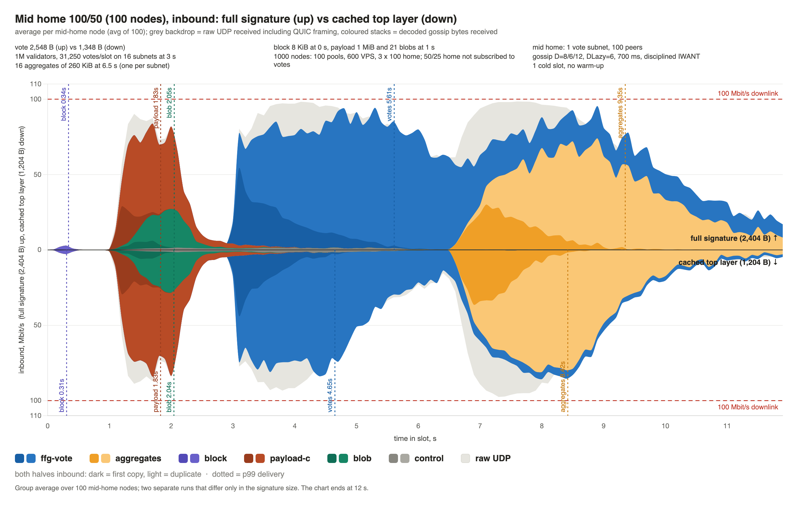
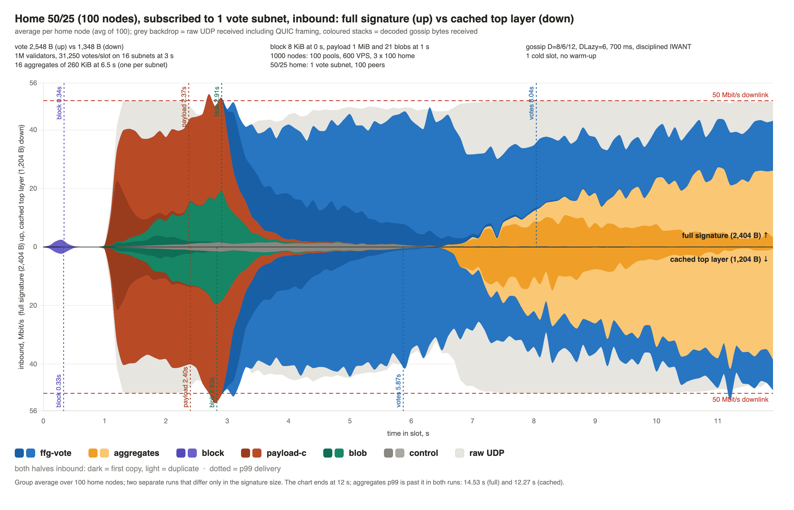
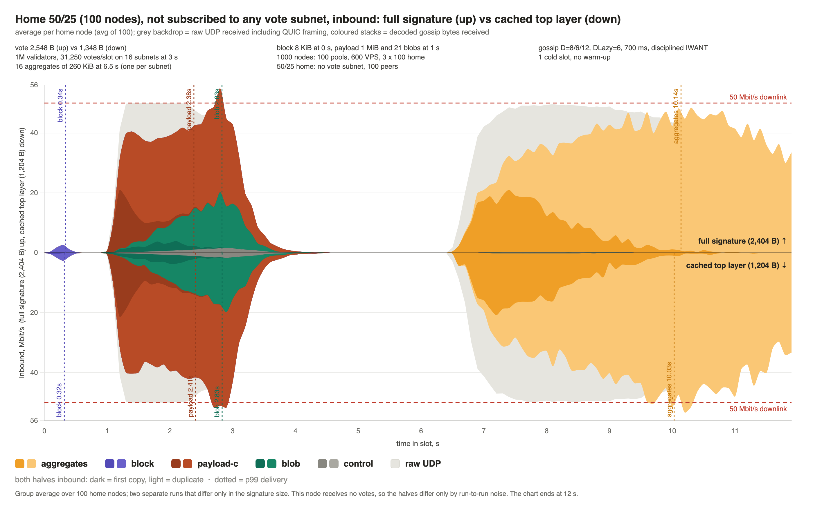

# Post-quantum attestations: top-layer caching

Follow-up to [pq-gasper.md](pq-gasper.md). A leanXMSS signature is two 1,200 B layers. The top layer
is the same for 2^16 consecutive signatures of a validator, so peers can cache it and a vote only
needs to carry the bottom layer: 1,204 B instead of 2,404 B.

**Result:** caching halves the vote traffic and brings votes and aggregates in earlier. It is still
not enough for the 50/25 Mbit home tier to subscribe to a vote subnet: its aggregates arrive after
the slot ends.

## Setup

Variant A of the first write-up, with block, 1 MiB payload and 21 blobs, one cold slot per run.

- Vote size 2,548 B (full signature) or 1,348 B (cached top layer). Nothing else changes.
- Every receiver is assumed to already hold every sender's top layer; cache misses are not modelled.
- The home tier (50/25 Mbit) is run both ways: **not subscribed** to any vote subnet, as in the first
  write-up, and **subscribed** to one, like the other home tiers.

## Arrival times

Seconds from slot start, p50 / **p99** / max. Votes are published at 3 s, aggregates at 6.5 s.

| Tier | Votes, full signature | Votes, cached top layer | Aggregates, full | Aggregates, cached |
|---|---|---|---|---|
| Pools (aggregators) | 3.23 / **3.84** / 4.38 | 3.19 / **3.67** / 4.08 | 6.84 / **7.12** / 7.35 | 6.83 / **7.12** / 7.36 |
| VPS | 3.41 / **4.59** / 5.15 | 3.29 / **4.16** / 4.72 | 6.94 / **7.44** / 7.95 | 6.96 / **7.49** / 8.00 |
| Upper home (200/100) | 3.49 / **4.74** / 5.12 | 3.33 / **4.13** / 4.50 | 7.08 / **7.81** / 8.02 | 7.04 / **7.73** / 8.04 |
| Mid home (100/50) | 3.67 / **5.61** / 6.67 | 3.44 / **4.65** / 5.46 | 7.47 / **9.35** / 10.54 | 7.23 / **8.42** / 8.75 |
| Home (50/25), not subscribed | not subscribed | not subscribed | 7.72 / **10.14** / 11.05 | 7.78 / **10.03** / 11.30 |
| Home (50/25), subscribed | 4.39 / **8.04** / 16.62 | 3.89 / **5.87** / 7.53 | 9.28 / **14.53** / 16.91 | 8.37 / **12.27** / 14.39 |

The first five rows are from the runs where the 50/25 tier is not subscribed, the last row from the
runs where it is.

## Traffic

Total UDP received per node per slot, MB (block, payload and blobs included):

| Tier | Full signature | Cached top layer |
|---|---|---|
| Pools (16 subnets) | 863 | 511 |
| VPS (2 subnets) | 128 | 81 |
| Upper home (1 subnet) | 84 | 57 |
| Mid home (1 subnet) | 98 | 68 |
| Home (50/25), not subscribed | 47 | 48 |
| Home (50/25), subscribed | 105 | 87 |

A subscribed vote subnet costs about 24 MB inbound per slot instead of 48 MB. Each vote is still
received about 9 times.

## Mid home (100/50)

Inbound traffic, full signature upwards, cached top layer downwards. With the cached layer the vote
wave is nearly over when the aggregates start, so they get the downlink to themselves.

## Home (50/25), subscribed to one vote subnet

Same layout. The downlink is full from 1 s to the end of the slot in both cases: a smaller signature
changes what fills the link, not whether it is full. Aggregates are still arriving at 12 s.

## Home (50/25), not subscribed to any vote subnet

Same layout and scale, for comparison. Without votes the link is idle between the blobs and the
aggregates, and the aggregates have the whole downlink: p99 arrival is about 10.1 s, inside the slot.
The signature size makes no difference to this node.

